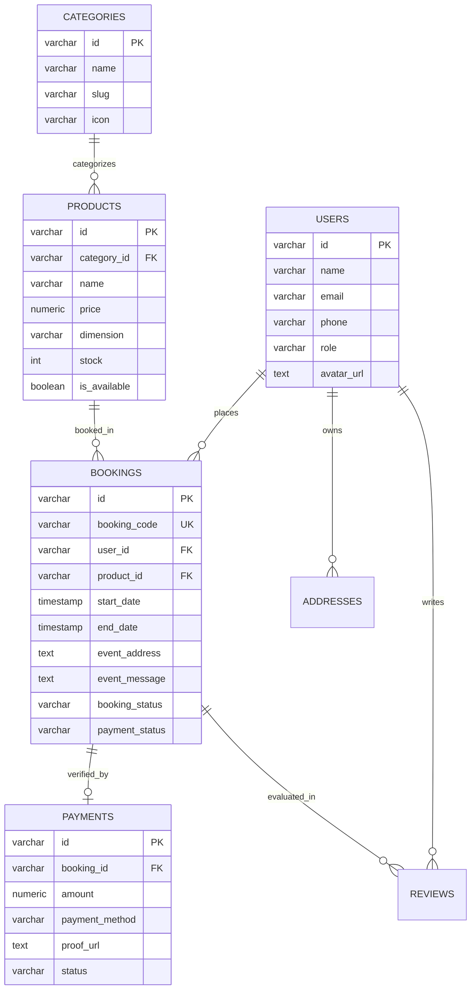

# Product Requirement Document (PRD) — GEMINIFLO

**Project Name**: GEMINIFLO  
**Tagline**: *Modern Florist & Ceremonial Flower Board (Papan Bunga) Booking & Rental Platform*  
**Document Version**: 1.0.0  
**Target Release**: Q4 2026  
**Repository**: [https://github.com/Amirul-Hasan99/GEMINIFLO](https://github.com/Amirul-Hasan99/GEMINIFLO)  
**Database**: Neon Serverless PostgreSQL (`ep-snowy-haze-at8e3hc2-pooler.c-9.us-east-1.aws.neon.tech`)  

---

## 1. Executive Summary & Product Vision

### 1.1 Problem Statement

Persewaan dan pemesanan papan bunga ucapan (seperti pernikahan, grand opening, duka cita, dan wisuda) di Indonesia secara tradisional masih sangat mengandalkan obrolan WhatsApp manual yang memicu sejumlah kendala:

- **Ketidakpastian Ketersediaan (Stock/Slot Availability)**: Sering terjadi overbooking pada tanggal-tanggal populer saat banyak acara pernikahan atau pembukaan bisnis berlangsung serentak.
- **Kesalahan Data Tulisan & Lokasi Pengiriman**: Kesalahan penulisan nama dan gelar, pesan ucapan, atau alamat venue pengiriman yang tidak terstruktur dengan baik.
- **Verifikasi Pembayaran yang Lambat & Rawan Penipuan**: Bukti transfer manual via WhatsApp sering tercecer sehingga memicu miskomunikasi antara kasir/admin dan tim produksi di workshop.
- **Ketiadaan Pelacakan Real-Time**: Pemesan tidak dapat mengetahui apakah papan bunga mereka sudah mulai dirangkai, dalam perjalanan kurir, sudah terpasang di lokasi, atau sudah selesai masa sewanya.

### 1.2 Product Vision

**GEMINIFLO** hadir sebagai solusi digital mobile-first untuk mendemokratisasi dan memodernisasi industri persewaan papan bunga dan florist ceremonial di Indonesia melalui beberapa pilar utama:

- Memberikan pengalaman booking interaktif berbasis kalender ketersediaan slot real-time.
- Menyediakan formulir pemesanan terstruktur khusus papan bunga yang mencakup nama pengirim, penerima, pesan ucapan banner, dan alamat venue acara.
- Menghadirkan **Two-Status Lifecycle Engine** yang memisahkan status pemesanan (*Booking Status*) dan status pembayaran (*Payment Status*) secara transparan.
- Menyediakan *Admin Command Desk* untuk verifikasi kilat bukti transfer, kontrol inventaris papan bunga, dan manajemen operasional lapangan.

---

## 2. User Personas

| Persona | Profil & Karakteristik | Kebutuhan Utama | Pain Points |
| :--- | :--- | :--- | :--- |
| **Penyewa Korporat / HR / Sekretariat** | Profesional kantor yang rutin memesan papan bunga untuk rekanan bisnis dan seremoni pembukaan cabang. | Pemesanan cepat, kwitansi/invoice resmi, verifikasi pembayaran kilat, dan jaminan papan sampai tepat waktu sebelum acara dimulai. | WhatsApp slow response, repot konfirmasi berulang kali, dan tidak ada invoice resmi. |
| **Penyewa Pribadi / Keluarga** | Mengirimkan ucapan simpati duka cita atau ucapan pernikahan untuk kerabat di luar kota. | Kemudahan memilih desain elegan, preview teks ucapan, dan kepastian waktu antar pada hari yang sama atau darurat. | Bingung memilih florist terpercaya dari kejauhan dan ragu apakah pesanan benar-benar diantar. |
| **Admin Florist / Owner GEMINIFLO** | Pengelola workshop dan armada logistik pengantaran serta pemasangan papan bunga. | Dashboard operasional sentral, approval kilat bukti transfer, filter order berdasarkan tanggal acara, dan kontrol rangka papan bunga. | Bukti transfer menumpuk di chat WhatsApp, lupa tanggal acara pelanggan, dan jadwal kurir bentrok. |

---

## 3. Core Features & Functional Requirements

### 3.1 Authentication & Profile

- **Registrasi & Login**: Otentikasi email dan password dengan validasi ketat, Secure Storage untuk token sesi, dan diferensiasi peran (`customer` vs `admin`).
- **Manajemen Profil**: Pembaruan biodata, nomor WhatsApp aktif untuk koordinasi kurir, dan foto profil.
- **Daftar Alamat Favorit**: Penyimpanan alamat venue langganan (seperti gedung pernikahan, ballroom hotel, atau rumah duka) agar dapat langsung dipilih kembali saat booking.

### 3.2 Katalog & Kalender Ketersediaan (Availability Explorer)

- **Kategori Bunga**:
  - `Pernikahan` (Wedding & Engagement)
  - `Grand Opening` (Pembukaan Kantor, Toko, Cabang Baru)
  - `Duka Cita` (Condolence & Simpati)
  - `Wisuda & Gelar` (Graduation & Achievement)
- **Live Status Badges**:
  - `Available`: Stok aman dan siap dibooking pada tanggal yang dipilih.
  - `Limited`: Tersisa kurang dari atau sama dengan 2 unit papan pada tanggal tertentu.
  - `Unavailable`: Slot ketersediaan telah habis terisi.
- **Filter & Search Cepat**: Pencarian real-time berdasarkan kata kunci nama produk, pengurutan harga, serta filter kategori.
- **Detail Produk**: Galeri foto resolusi tinggi, spesifikasi dimensi (contoh: 2.0m x 1.5m), jenis rangkaian bunga (segar atau suyok premium), serta ulasan dan rating pelanggan.

### 3.3 Alur Pemesanan Interaktif (Structured Booking Flow)

- **Pemilihan Tanggal Acara**: Menentukan tanggal pasang (*Start Date*) hingga selesai atau bongkar (*End Date*).
- **Formulir Khusus Papan Bunga**:
  - Nama Penerima, Pengantin, atau Nama Toko (contoh: "The Wedding of Andi & Sarah").
  - Nama Pengirim (contoh: "Direksi & Staff PT Gemilang Nusantara").
  - Pesan atau Ucapan Banner (contoh: "Selamat & Sukses atas Grand Opening Cabang Surabaya").
  - Alamat Venue Acara Lengkap beserta catatan patokan akses gedung bagi kurir.
  - Opsi Layanan Tambahan: Pilihan gratis ongkir area tertentu dan jasa pemasangan rangka di venue.
- **Kalkulasi Total Otomatis**: Perhitungan tarif harian dikalikan durasi hari sewa beserta biaya layanan tambahan.

### 3.4 Pembayaran & Unggah Bukti Transfer

- **Metode Pembayaran**:
  - Transfer Bank Manual (BCA, Mandiri, BNI, BRI) dengan nomor rekening resmi toko.
  - E-Wallet (GoPay, DANA, OVO).
  - QRIS Dinamis atau Statis.
- **Unggah Bukti Transfer (Proof of Payment)**:
  - Input foto bukti transfer atau tangkapan layar m-banking dari galeri atau kamera langsung.
  - Pratinjau gambar sebelum konfirmasi pengiriman.
- **Dual-Status Engine**:
  - *Payment Status*: `unpaid` ➔ `verifying` ➔ `paid` (atau `rejected` disertai alasan penolakan).
  - *Booking Status*: `pending` ➔ `confirmed` ➔ `in_production` ➔ `delivered` ➔ `completed`.
- **Integrasi Direct WhatsApp Customer Service**: Tautan langsung menuju WhatsApp admin florist untuk kebutuhan darurat atau konfirmasi cepat.

### 3.5 Admin Command Center & Desk Verifikasi

- **Dashboard Ringkasan Operasional**: Metrik total pesanan aktif, antrean verifikasi bukti transfer yang belum ditinjau, dan total pendapatan.
- **Verifikasi Bukti Transfer**:
  - Peninjauan gambar struk berdampingan dengan rincian nama penyewa dan nominal pesanan.
  - Tindakan *Approve*: Mengubah status pembayaran menjadi lunas dan status pesanan menjadi dikonfirmasi.
  - Tindakan *Reject*: Menampilkan modal alasan penolakan wajib untuk dinotifikasikan ke pembeli.
- **Manajemen Inventaris**: Pengelolaan data produk papan bunga, pembaruan stok rangka, serta sakelar ketersediaan produk.

---

## 4. Non-Functional Requirements (NFR)

| Kategori | Spesifikasi |
| :--- | :--- |
| **Performance** | Waktu pemuatan awal di bawah 2.5 detik, transisi layar lancar 60 FPS, serta caching gambar dengan shimmer placeholder. |
| **Database & Scalability** | Menggunakan Neon Serverless PostgreSQL dengan pooler aktif (`ep-snowy-haze-at8e3hc2-pooler`) untuk latensi rendah dan auto-scaling. |
| **Security** | Penyimpanan token sesi pengguna terenkripsi via `flutter_secure_storage` serta koneksi database dengan SSL Mode `require`. |
| **Reliability** | Arsitektur dual-mode: aplikasi beralih ke cache data lokal secara elegan jika terjadi gangguan jaringan agar antarmuka tidak crash. |
| **Code Quality** | Flutter SDK modern (^3.13.4) dengan aturan linter ketat, menghasilkan 0 error, 0 warning, dan 0 lint pada `flutter analyze`. |

---

## 5. Technical Stack

- **Framework**: Flutter (Dart 3.x)
- **State Management**: Flutter Riverpod 3 (`^3.4.3`) dengan pola modern `Notifier` dan `NotifierProvider`
- **Routing**: `go_router` (`^18.0.1`) dengan declarative navigation
- **Database**: **Neon Serverless PostgreSQL** via driver resmi `postgres: ^3.5.15` (SSL Mode Required)
- **Local Storage**: `shared_preferences` dan `flutter_secure_storage`
- **Network / HTTP**: `dio` (`^5.11.1`)
- **Typography & Icons**: `google_fonts` (Plus Jakarta Sans) beserta Cupertino dan Material Icons

---

## 6. Database Schema (Neon PostgreSQL)

---

## 7. Milestones & Implementation Roadmap

- [x] **Phase 1: UI/UX & Design System Implementation** (16 Screens: Katalog, Booking, Pembayaran, Admin Desk).
- [x] **Phase 2: State Management & Code Stabilization** (Riverpod 3 migration, zero-lint `flutter analyze`, unit tests passing).
- [x] **Phase 3: Database Integration** (Neon Serverless PostgreSQL schema initialization, table creation, seed catalog data).
- [ ] **Phase 4: Real-time Push & WebSocket Updates** (Integrasi notifikasi status papan bunga & bukti transfer).
- [ ] **Phase 5: Release Build & Distribution** (Release APK, App Bundle signed, Google Play Store distribution).
